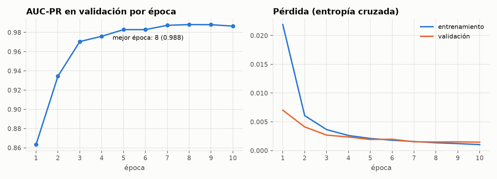
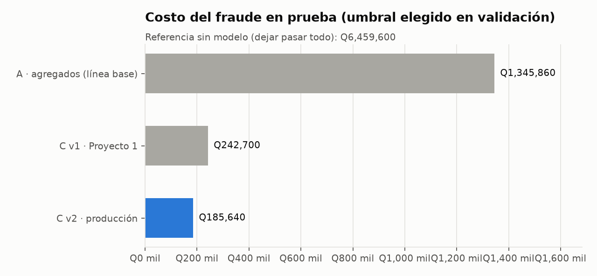
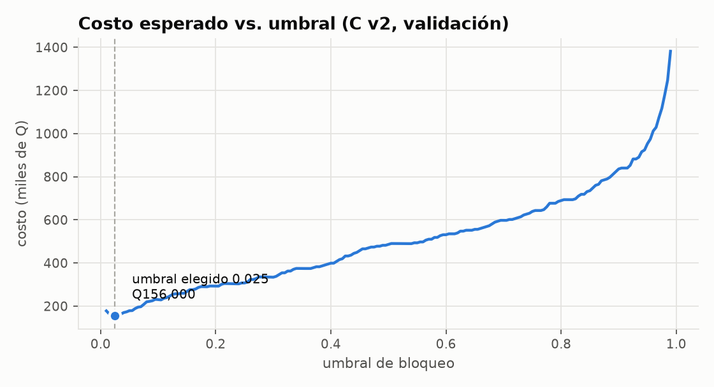
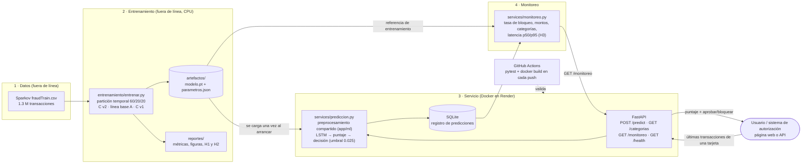
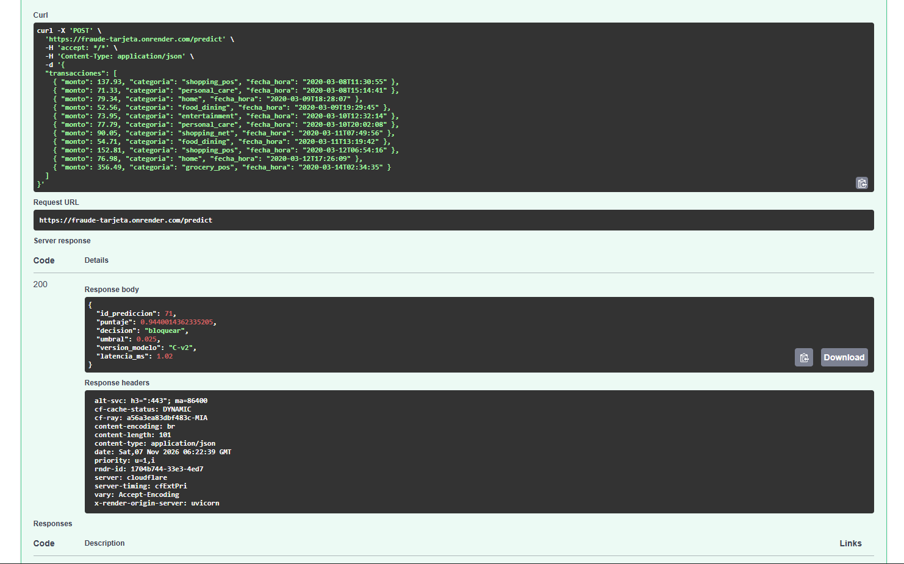
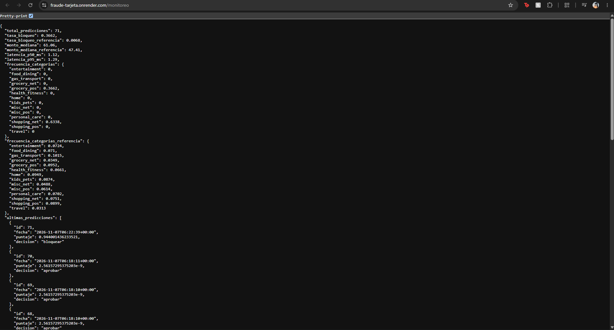
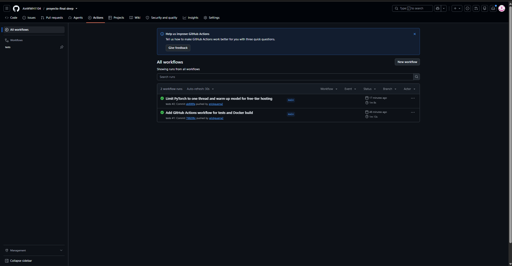

# Proyecto Final: Detección de fraude con tarjeta en producción

Deep Learning y Sistemas Inteligentes 2026 · Universidad del Valle de Guatemala
**Integrantes:** Iris Ayala · Anggie Quezada · Erick Guerra

Servicio que recibe las transacciones recientes de una tarjeta y devuelve, en línea, un **puntaje de riesgo de fraude**
y la decisión **aprobar / bloquear**. El modelo es una LSTM con embedding de categoría de comercio (Modelo C del
Proyecto 1), corregida y reentrenada para producción.

- **Servicio en línea (página para probar el modelo):** <https://fraude-tarjeta.onrender.com> (plan gratuito: si estuvo inactivo, la primera carga tarda ~1 min)
- **Panel de monitoreo:** <https://fraude-tarjeta.onrender.com/monitoreo.html>
- **Documentación interactiva de la API:** <https://fraude-tarjeta.onrender.com/docs> · **Monitoreo:** <https://fraude-tarjeta.onrender.com/monitoreo>
- **Presentación:** [`docs/presentacion.pdf`](docs/presentacion.pdf) _TODO (Anggie)_

---

## 1. Problemática

**El problema.** Cuando alguien paga con tarjeta, el banco tiene unos milisegundos para decidir si **aprueba** o
**bloquea** la transacción. Si aprueba un fraude, el banco absorbe la pérdida (en promedio **Q4,200** por fraude no
detectado: monto robado, contracargo y gestión). Si bloquea una compra legítima, pierde menos dinero (**Q180** en
promedio: atención al cliente, la venta perdida y el riesgo de que el cliente deje de usar la tarjeta), pero molesta a
un cliente bueno. El fraude es raro (0.58 % de las transacciones en los datos), así que revisar todo a mano es
imposible y una regla fija (por ejemplo, "bloquear todo arriba de Q500") se equivoca en ambos sentidos: los
defraudadores suelen hacer compras de montos normales, y los clientes a veces hacen compras grandes.

**El usuario y la decisión.** El usuario es el **área de riesgos del banco**, a través del **sistema de autorización**
que llama a este servicio en cada compra. El servicio recibe las últimas transacciones de la tarjeta, devuelve un
**puntaje de riesgo** de 0 a 1 y la decisión: **bloquear** si el puntaje es ≥ 0.025 o **aprobar** si no. El modelo
no mira solo la compra actual, sino **la secuencia**: qué se compró antes, cuánto, a qué hora y cuánto tiempo pasó
entre compras. Como un fraude cuesta **23 veces más** que un bloqueo, el umbral está elegido para minimizar el costo
total y no para "acertar más": conviene bloquear de más a dejar pasar fraudes. Para que alguien sin conocimientos técnicos
lo pruebe, la [página web](https://fraude-tarjeta.onrender.com) permite cargar un ejemplo, editar las transacciones y ver la decisión con
una explicación.

## 2. Planificación

Trabajamos por turnos sobre `main`, un integrante a la vez, con el plan y el contrato de la API definidos desde el
inicio ([`docs/plan_trabajo.md`](docs/plan_trabajo.md)). Fechas reales tomadas del historial de commits:

| Etapa                                                                                | Responsable    | Planeado      | Terminado       |
| ------------------------------------------------------------------------------------ | -------------- | ------------- | --------------- |
| Elegir el modelo (C del Proyecto 1) y revisar su método                              | Todos          | 6 nov         | 6 nov           |
| Estructura del repo, pipeline de entrenamiento e hipótesis pre-registradas           | Iris           | 6 nov         | 6 nov           |
| Reentrenamiento C v2, evaluación contra líneas base, README secciones 4–5           | Iris           | 6 nov         | 6 nov           |
| API: `POST /predict` y `GET /categorias` con sus tests                               | Iris           | 6 nov         | 6 nov           |
| Registro en SQLite, `GET /monitoreo`, Docker y GitHub Actions                        | Erick          | 7–8 nov       | 6 nov (noche)   |
| Despliegue en Render, ajuste de latencia, README secciones 6–7 y H3                  | Erick          | 8 nov         | 7 nov           |
| Interfaz web (`/`) y página de monitoreo (`/monitoreo.html`)                         | Anggie         | 8 nov         | 8 nov           |
| README secciones 1–3                                                                 | Anggie         | 8 nov         | 8 nov           |
| Pruebas con al menos 5 usuarios externos y capturas                                  | Anggie         | 8 nov         | _pendiente_     |
| Presentación PDF                                                                     | Anggie         | 8 nov         | _pendiente_     |
| Ensayo con preguntas cruzadas                                                        | Todos          | 8 nov (noche) | _pendiente_     |
| **Presentación ante el comité**                                                      | Todos          | 9 o 13 nov    | _pendiente_     |
| Ajustes según retroalimentación                                                      | Todos          | hasta 15 nov  | _pendiente_     |

## 3. Supuestos

- **Datos.** Sparkov es un conjunto **simulado** (983 tarjetas, 2019–2020). Suponemos que la forma del fraude
  (compras de madrugada, montos altos en ciertas categorías, ráfagas después de un periodo normal) se parece a la real.
  _Si no se cumple:_ el AUC-PR de 0.989 no se trasladaría a datos reales; antes de usarlo en un banco habría que
  reentrenar y validar con su historial.
- **Estabilidad del fraude.** Suponemos que el fraude futuro se parece al del periodo de entrenamiento.
  _Si no se cumple:_ aparecen patrones nuevos que el modelo no conoce y el recall baja. `/monitoreo` lo vigila
  comparando la tasa de bloqueo, los montos y las categorías contra la referencia de entrenamiento.
- **Entrada.** Quien llama a la API envía las últimas transacciones **de una sola tarjeta** (de 1 a 20; la más reciente
  por fecha es la que se evalúa), con fecha y hora **local** de la transacción, monto en quetzales y una de las
  **14 categorías** conocidas. _Si no se cumple:_ una categoría nueva o un monto ≤ 0 se rechazan con 422; si se mezclan
  tarjetas o la hora viene en otra zona horaria, el puntaje pierde sentido sin que el servicio lo detecte.
- **Montos.** El modelo se entrenó con montos de Sparkov (en dólares) y los tratamos como quetzales.
  _Si no se cumple:_ con montos reales en quetzales (≈ 7.7 veces mayores) todo parecería "más caro" de lo normal;
  habría que reentrenar con montos locales.
- **Costos.** Q4,200 por fraude no detectado y Q180 por bloqueo legítimo son **promedios fijos**.
  _Si no se cumple:_ si cambian (o dependen del monto), cambia el umbral óptimo; el pipeline permite recalcularlo en validación.
- **Historial.** Una tarjeta nueva, con pocas transacciones, se evalúa con lo que haya (el resto de la ventana se
  rellena). _Si no se cumple:_ con poco historial el modelo tiene menos contexto y es menos confiable.
- **Entorno.** El servicio corre en CPU, sin GPU, en un plan gratuito que se duerme tras 15 minutos sin uso y borra el
  disco al reiniciar. _Si no se cumple_ (por ejemplo, en producción real): habría que usar una base de datos
  persistente y un servidor siempre encendido; el código ya separa la persistencia en `app/repositories/` para ese cambio.

## 4. Modelo planteado

**Proyecto de origen:** Proyecto 1, _"El orden revela: monitoreo transaccional"_. Se
eligió el **Modelo C**, que fue el mejor del proyecto: AUC-PR de 0.983 en prueba contra 0.726 de la línea base sin secuencia.

**Arquitectura** ([`app/ml/modelo.py`](app/ml/modelo.py)), 5,469 parámetros:

```
últimas 10 transacciones de la tarjeta  →  (10 × 5)
   ├─ categoría de comercio → Embedding(15 × 4)     (código 0 = relleno, vector cero)
   └─ log(1+monto), hora, log(1+días desde la anterior), es_real  (estandarizados)
                     ↓ concatenar (10 × 8)
              LSTM (1 capa, 32 unidades)
                     ↓ último estado oculto
              Lineal(32 → 1) + sigmoide  →  puntaje de riesgo ∈ [0, 1]
                     ↓
       puntaje ≥ 0.025  →  BLOQUEAR      ·      puntaje < 0.025  →  APROBAR
```

**Cambios respecto al Proyecto 1, y por qué.** Al revisar el notebook original para llevarlo a producción encontramos
cuatro problemas de método. Los corregimos sin cambiar la arquitectura ni los hiperparámetros:

| #   | Problema en el Proyecto 1                                                                                  | Por qué importa                                                                                           | Corrección                                                                                                                  |
| --- | ---------------------------------------------------------------------------------------------------------- | --------------------------------------------------------------------------------------------------------- | --------------------------------------------------------------------------------------------------------------------------- |
| 1   | El umbral 0.06 se eligió minimizando el costo **en el conjunto de prueba**.                                | El costo reportado era optimista: se "ajustó" con los datos que debían ser nuevos.                        | El umbral se elige en **validación**; prueba solo se usa para reportar.                                                     |
| 2   | El relleno de secuencias (ceros) y las categorías desconocidas compartían el código 0 con `entertainment`. | Una tarjeta con poco historial "parecía" tener compras de entretenimiento de Q0.                          | Código 0 reservado para relleno (`padding_idx=0`), categorías 1–14 y variable `es_real`.                                    |
| 3   | Variables sin escalar (montos de miles junto a horas 0–23).                                                | Entrenamiento menos estable; el monto domina la entrada.                                                  | `log(1+monto)`, hora y `log(1+días)`, estandarizados con media y desviación **de entrenamiento**.                           |
| 4   | El historial de cada tarjeta se reiniciaba al inicio de validación y de prueba.                            | En producción la tarjeta ya tiene historial: el modelo se evaluaba en condiciones distintas a las reales. | Variables calculadas sobre el historial completo, siempre hacia atrás en el tiempo; las etiquetas nunca cruzan particiones. |

Además, el modelo guardado es el de **la época con mejor AUC-PR en validación** (época 8 de 10), no el de la última.

**Datos y partición.** Sparkov `fraudTrain.csv`: 1,296,675 transacciones de 983 tarjetas, con 0.58 % de fraude.
La partición es temporal, la misma del Proyecto 1:

| Conjunto      | Transacciones | Periodo                            |
| ------------- | ------------- | ---------------------------------- |
| Entrenamiento | 778,005       | 2019-01-01 → 2019-11-29            |
| Validación    | 259,335       | 2019-11-29 → 2020-03-06            |
| Prueba        | 259,335       | 2020-03-06 → 2020-06-21 (107 días) |

El diccionario de categorías, el escalado, la época y el umbral se ajustan **solo** con entrenamiento y validación.
Entrenamiento y servicio usan **la misma función** de preprocesamiento ([`app/ml/preprocesamiento.py`](app/ml/preprocesamiento.py)),
y un test verifica que ambos arman la misma ventana.



## 5. Validación de hipótesis

Las hipótesis, métricas y criterios de éxito se registraron **antes de reentrenar**, en [`docs/hipotesis.md`](docs/hipotesis.md)
(ver la fecha del commit). El script de entrenamiento los evalúa automáticamente ([`entrenamiento/hipotesis.py`](entrenamiento/hipotesis.py)).

**Resultados en prueba.** Cada modelo usa el umbral de mínimo costo **elegido en validación**:

| Modelo                                            | AUC-PR    | Umbral | Recall    | Precisión | Fraudes no detectados | Bloqueos legítimos | Costo en prueba |
| ------------------------------------------------- | --------- | ------ | --------- | --------- | --------------------- | ------------------ | --------------- |
| Sin modelo (dejar pasar todo)                     | —         | —      | 0         | —         | 1,538                 | 0                  | Q6,459,600      |
| **A**: agregados + gradient boosting (línea base) | 0.703     | 0.040  | 0.850     | 0.385     | 231                   | 2,087              | Q1,345,860      |
| **C v1**: Proyecto 1, tal como se entregó         | 0.983     | 0.045  | 0.978     | 0.731     | 34                    | 555                | Q242,700        |
| **C v2**: producción                              | **0.989** | 0.025  | **0.984** | **0.772** | **25**                | **448**            | **Q185,640**    |



| Hipótesis                                             | Criterio (definido antes)                         | Resultado                                       | ¿Cumple?    |
| ----------------------------------------------------- | ------------------------------------------------- | ----------------------------------------------- | ----------- |
| **H1:** C v2 reduce el costo frente a la línea base A | costo(C v2) ≤ 50 % de costo(A) **y** AUC-PR +0.10 | costo = **13.8 %** del de A; AUC-PR **+0.286**  | ✅ Sí       |
| **H2:** las correcciones no empeoran el modelo        | AUC-PR(C v2) ≥ AUC-PR(C v1) − 0.01                | **+0.006**                                      | ✅ Sí       |
| **H3:** el servicio responde a tiempo                 | latencia p95 < 300 ms                             | p95 = **1.29 ms** (p50 = 1.12 ms) en 71 predicciones del servicio desplegado | ✅ Sí |

**Lectura de los resultados**

- **Frente a la línea base A**, C v2 deja pasar 25 fraudes en lugar de 231 y bloquea 448 clientes legítimos en lugar
  de 2,087. El costo baja de Q1.35 M a Q0.19 M en los 107 días de prueba: unos **Q325,000 menos por mes**.
- **Frente a no tener modelo**, el ahorro es de Q6.27 M en el periodo, unos **Q1.76 M por mes**.
- **Frente al Proyecto 1**, C v2 mejora un poco en todo (+0.006 AUC-PR, 9 fraudes menos y 107 bloqueos menos), con un
  costo Q57,060 menor. La razón principal para usar C v2 no es esa mejora, sino que **se evaluó con método correcto**:
  el Proyecto 1 reportaba Q235,620 con un umbral elegido mirando la prueba; con un umbral elegido en validación, C v1 cuesta Q242,700.
- **El umbral importa tanto como el modelo:** el mismo C v2 con el umbral por defecto de 0.5 cuesta Q449,160, 2.4 veces
  más, porque deja pasar 106 fraudes. Como un fraude cuesta 23 veces más que un bloqueo, conviene un umbral bajo.
- **Reproducibilidad:** el pipeline reproduce exactamente el AUC-PR de C v1 que reportó el Proyecto 1 (0.9827). El
  modelo A da 0.703 en lugar de 0.726 porque ahora sus agregados también usan el historial completo de la tarjeta.



**Límites conocidos:** los datos son simulados; las categorías con pocos fraudes (travel, grocery_net) tienen menor
recall; no se probó contra mecanismos de fraude nuevos. El monitoreo (sección 6) existe para detectar cuándo el
tráfico real se aleja de lo que vio el modelo.

## 6. Herramientas y arquitectura

**Diagrama del sistema: datos → entrenamiento → servicio → monitoreo**



**Flujo de una predicción.** El cliente envía de 1 a 20 transacciones de una tarjeta. La API valida el formato (Pydantic) y
el servicio arma la ventana de las últimas 10 con **la misma función** que usó el entrenamiento, calcula el puntaje con la
LSTM y decide con el umbral elegido en validación. Cada predicción válida se guarda en SQLite (fecha, puntaje, decisión,
latencia, versión del modelo, número de transacciones, y monto y categoría de la transacción evaluada) **sin datos
personales**: el contrato no incluye número de tarjeta. `GET /monitoreo` resume ese registro y lo pone al lado de la
referencia de entrenamiento (`parametros.json` → `referencia`) para detectar deriva.

**Herramientas y por qué**

| Herramienta             | Para qué                                     | Por qué esta                                                                                                                                                   |
| ----------------------- | -------------------------------------------- | -------------------------------------------------------------------------------------------------------------------------------------------------------------- |
| **PyTorch (CPU)**       | Modelo LSTM, entrenamiento e inferencia      | Es el framework del Proyecto 1, así que el modelo se reutiliza sin reescribirlo. La versión CPU basta (5,469 parámetros, ~ms por predicción) y la imagen pesa mucho menos que con CUDA. |
| **FastAPI**             | API HTTP (`/predict`, `/monitoreo`, …)       | Valida la entrada con Pydantic (422 automático si algo no cumple el contrato) y genera la documentación interactiva en `/docs`, que sirve para que alguien externo la pruebe sin instalar nada. |
| **SQLite**              | Registro de predicciones para el monitoreo   | Viene con Python (`sqlite3`), no necesita un servidor aparte y alcanza para el volumen de un piloto. Si el uso crece, se cambia solo `app/repositories/` por PostgreSQL. |
| **uv**                  | Entorno y dependencias                       | Un solo `uv.lock` garantiza las mismas versiones en local, en CI y en Docker. Los grupos separan el servicio del entrenamiento: la imagen no instala pandas ni sklearn. |
| **Docker**              | Empaquetar el servicio                       | La misma imagen corre en cualquier computadora y en la nube; incluye solo `app/`, `artefactos/` y las dependencias del servicio.                              |
| **Render**              | Hospedaje público del servicio               | Plan gratuito que construye el `Dockerfile` directo desde GitHub y redespliega en cada push a `main`. El servicio usa ~290 MB de los 512 MB disponibles; PyTorch se limita a un hilo para que la fracción de CPU no genere picos de latencia. Limitaciones: se duerme tras 15 min sin uso (la primera petición tarda ~1 min en despertarlo) y el disco se borra al reiniciar, por eso las evidencias se exportan a `docs/evidencias/`. Hugging Face Spaces, la primera opción, ya no permite Docker en su plan gratuito. |
| **GitHub Actions**      | Integración continua                         | Corre `pytest` (incluye entrenar un modelo con datos sintéticos de punta a punta) y construye la imagen Docker en cada push, para no subir un cambio que rompa el servicio. |

**Estructura del código** (capas con una sola responsabilidad cada una):

```
app/                         SERVICIO (lo que se despliega)
  main.py                    crea la app y carga el modelo una vez al arrancar (lifespan)
  core/config.py             configuración por variables de entorno
  api/                       rutas HTTP y esquemas de entrada/salida (solo validan y delegan)
  services/                  lógica: predicción, decisión, monitoreo
  repositories/              persistencia del registro de predicciones (SQLite)
  ml/                        arquitectura, preprocesamiento compartido y carga de artefactos
  web/                       interfaz web
entrenamiento/               PIPELINE: CSV → modelo + métricas + figuras
  entrenar.py                comando principal
  datos.py · entrenador.py · lineas_base.py · metricas.py · hipotesis.py · reportes.py
  exportar_ejemplos.py       genera docs/ejemplos/*.json desde el conjunto de prueba
artefactos/                  modelo.pt + parametros.json (C v2) y v1_proyecto1/ (línea base)
reportes/                    metricas.json y figuras del último entrenamiento
docs/                        hipótesis, plan de trabajo, ejemplos, presentación
tests/                       pruebas automáticas (pytest)
```

## 7. Evidencias del pase a producción

**Servicio público:** <https://fraude-tarjeta.onrender.com> · documentación interactiva en [`/docs`](https://fraude-tarjeta.onrender.com/docs) · monitoreo en [`/monitoreo`](https://fraude-tarjeta.onrender.com/monitoreo).

**Documentación interactiva (`/docs`).** Cualquiera puede probar `POST /predict` desde el navegador con los ejemplos de
[`docs/ejemplos/`](docs/ejemplos/): el ejemplo de fraude da puntaje 0.944 → **bloquear** y el legítimo da ≈ 0 → **aprobar**,
igual que en el pipeline de entrenamiento (lo verifica `tests/test_predict.py`).



**Registros de uso (`/monitoreo`).** Cada predicción queda registrada; el resumen exportado está en
[`docs/evidencias/monitoreo.json`](docs/evidencias/monitoreo.json) (el disco del plan gratuito se borra al reiniciar).



**Latencia (H3).** Con 71 predicciones en el servicio desplegado (los dos ejemplos), el registro da
**p50 = 1.12 ms y p95 = 1.29 ms**, muy por debajo del criterio de 300 ms: **H3 se cumple**. Es el tiempo de procesamiento
dentro del servicio (validar, preprocesar, LSTM y decidir), que es lo que define H3. Medido desde un cliente en Guatemala, la ida y
vuelta completa por internet fue de ~234 ms de mediana (máximo 322 ms en 20 peticiones), y casi todo es red. Para lograrlo
en el plan gratuito (fracción de CPU) PyTorch usa un solo hilo y el modelo se "calienta" al arrancar; sin eso, la primera
petición tardaba ~700 ms y aparecían picos de hasta 4 s.

**Pruebas automáticas.** `uv run pytest` corre 30 pruebas: contrato de la API, entradas inválidas (422), que el modelo de
producción reproduzca los ejemplos, que entrenamiento y servicio armen la misma ventana, y el registro y monitoreo.
GitHub Actions las corre, y construye la imagen Docker, en cada push:



> _TODO (Anggie)._ Capturas de la interfaz web y registro de los usuarios externos
> ([`docs/evidencias/pruebas_usuarios.md`](docs/evidencias/pruebas_usuarios.md)).

---

## Cómo ejecutar

Requisitos: [uv](https://docs.astral.sh/uv/) (instala Python 3.12 automáticamente).

```bash
uv sync                          # instala dependencias (servicio + entrenamiento + tests)
uv run fastapi dev               # servicio en http://127.0.0.1:8000  (documentación en /docs)
uv run pytest                    # pruebas (no necesitan el CSV)
```

**Con Docker** (la misma imagen que se despliega):

```bash
docker build -t fraude .
docker run -p 8000:8000 fraude   # http://127.0.0.1:8000/docs
```

**Desplegar en Render:** en [render.com](https://render.com), _New → Web Service_, conectar este repositorio,
_Language: Docker_, plan _Free_ y _Health Check Path_ `/health`. Render construye el `Dockerfile` y redespliega en cada push a `main`.

**Reentrenar** (opcional; el modelo entrenado ya está en `artefactos/`): descargar `fraudTrain.csv` del dataset
[Sparkov en Kaggle](https://www.kaggle.com/datasets/kartik2112/fraud-detection) en `datos/` y correr:

```bash
uv run python -m entrenamiento.entrenar          # ~4 min en CPU; regenera artefactos/ y reportes/
uv run python -m entrenamiento.exportar_ejemplos # regenera docs/ejemplos/
```

Semilla fija (42); la partición y todos los ajustes se recalculan desde el CSV.

## Uso de inteligencia artificial

> _TODO (los tres)._ Cada integrante declara para qué usó asistentes de IA. Ejemplo:
>
> - **Iris:** Claude Code para revisar el método del Proyecto 1 (detectó los 4 problemas de la sección 4), estructurar el
>   pipeline de entrenamiento y redactar borradores de las secciones 4 y 5. Revisamos y ejecutamos todo el código.
> - **Erick:** Claude Code como ayuda para el desarrollo y revisión de código, así como para el despliegue de la API. También ayudó a tomar la decisión de migrar a Render debido a que Hugging Face no permite utilizar Docker en cuentas gratuitas.
> - **Anggie:** Claude Code para revisar la interfaz web y apoyo en sus tests. apoyo en redacción de borradores de las secciones 1–3 del README a partir del plan de trabajo y del historial del repositorio.